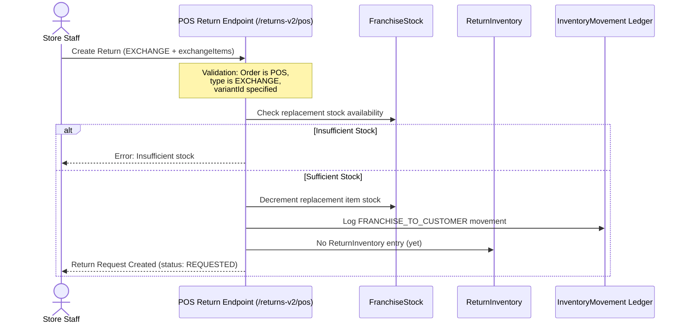
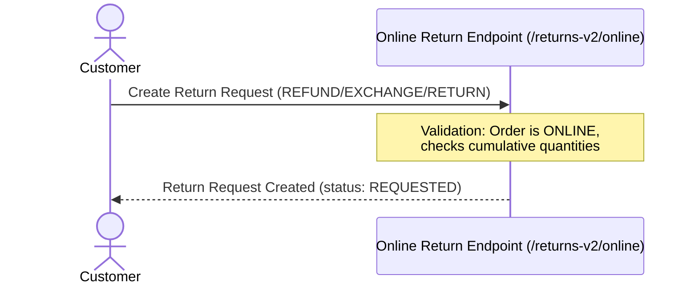
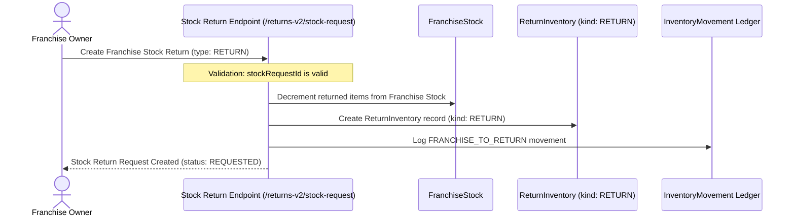
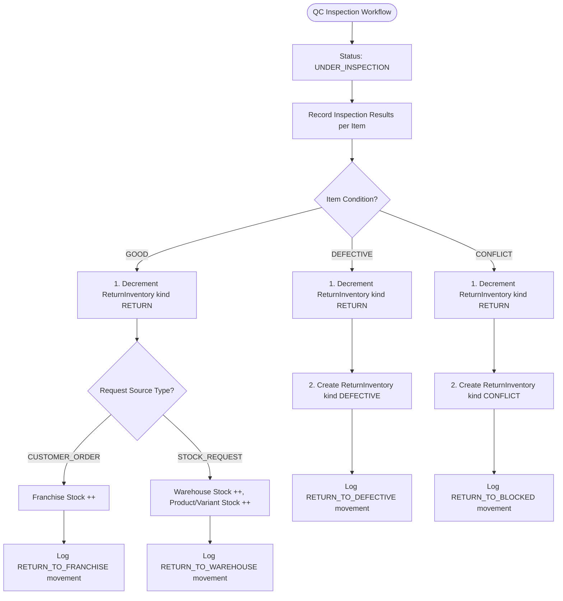

# Return Management V2 Workflow & System Flows

This document details how the Return Management V2 module processes Customer Order Returns, Customer Refunds, Customer Exchanges, Franchise Stock Returns, and the QC/Inspection workflow, complete with system validations and inventory ledger logs.

---

## 1. Request Initiation Flow

Depending on the return channel, the request is routed to one of three endpoints, enforcing strict validation and stock rules.

### POS / Offline Exchange
* **Endpoint**: `POST /returns-v2/pos`
* **Rules**: 
  - Original order channel must be `POS`.
  - Return type must be `EXCHANGE`.
  - Must include `exchangeItems` representing the replacement items.
  - If a variant product is chosen, `variantId` is required.
  - Immediately verifies stock of replacement items, decrements `FranchiseStock`, and logs `FRANCHISE_TO_CUSTOMER` ledger entry.
  - Accepts an optional array of `images` uploaded by store staff showing the returned item state.

### Online Return
* **Endpoint**: `POST /returns-v2/online`
* **Rules**:
  - Original order channel must be `ONLINE`.
  - Allows `RETURN`, `REFUND`, or `EXCHANGE`.
  - Rejects if cumulative return quantities exceed the original order's item quantities.
  - Accepts an optional array of `images` uploaded by the customer showing proof of defect or item condition.

### Franchise Stock Return
* **Endpoint**: `POST /returns-v2/stock-request`
* **Rules**:
  - Requires a valid `stockRequestId` (simulating franchise stock return to warehouse).
  - Return type must be `RETURN`.
  - Immediately decrements `FranchiseStock`, increments `ReturnInventory` (kind `RETURN`), and logs `FRANCHISE_TO_RETURN` movement.
  - Accepts an optional array of `images` showing the returned package state.

---

## 2. Receipt and Inspection Flow

Once items are received at the franchise or warehouse, they undergo a quality control (QC) check.

### Step A: Receipt at Franchise
When a return request status transitions to `RECEIVED_AT_FRANCHISE`:
- Records who received it, when, and at which franchise (`receivedFranchiseId`, `receivedByUserId`, `receivedAt`).
- Increments `ReturnInventory` (kind `RETURN`) to track that items are physically returned but not yet inspected.
- Logs `CUSTOMER_TO_RETURN` ledger entry.

### Step B: Quality Control (QC) Inspection
When the inspection results are submitted (`QC_PASSED` status):
- The returned item count is decremented from `ReturnInventory` (kind `RETURN`).
- Items are evaluated based on their quality condition:

---

## 3. Inventory Movement Ledger Types

All database-level stock adjustments write to the `InventoryMovement` log/ledger, enabling audit trails of inventory flows:

| Movement Type | Source -> Destination | Description | Trigger Event |
| :--- | :--- | :--- | :--- |
| `CUSTOMER_TO_RETURN` | Customer $\rightarrow$ ReturnInventory | Tracks receipt of customer return request items at the franchise | Transition to `RECEIVED_AT_FRANCHISE` |
| `FRANCHISE_TO_CUSTOMER` | FranchiseStock $\rightarrow$ Customer | Deducts replacement items from franchise stock for exchanges | Request creation (POS) or Exchange Order setup (Online) |
| `FRANCHISE_TO_RETURN` | FranchiseStock $\rightarrow$ ReturnInventory | Transfers franchise stock to return holding for returns to warehouse | Request creation (Franchise Stock Return) |
| `RETURN_TO_FRANCHISE` | ReturnInventory $\rightarrow$ FranchiseStock | Adds GOOD condition items back to active store inventory | QC Passed (Customer Returns) |
| `RETURN_TO_WAREHOUSE` | ReturnInventory $\rightarrow$ WarehouseStock | Adds GOOD condition items back to central warehouse inventory | QC Passed (Franchise Stock Returns) |
| `RETURN_TO_DEFECTIVE` | ReturnInventory $\rightarrow$ ReturnInventory (DEFECTIVE) | Segregates damaged items to defective stock | QC Passed (Condition: DEFECTIVE) |
| `RETURN_TO_BLOCKED` | ReturnInventory $\rightarrow$ ReturnInventory (CONFLICT) | Holds disputed/conflict items in blocked stock | QC Passed (Condition: CONFLICT) |

---

## 4. Status Transition Endpoints & Swagger Workflow

To keep the Swagger documentation simple and clear, the workflow uses two status transition endpoints:

1. **General Status Transitions**: `PATCH /returns-v2/:id/status`
   - **Allowed Transitions**:
     - `REQUESTED` $\rightarrow$ `APPROVED` or `REJECTED`
     - `APPROVED` $\rightarrow$ `RECEIVED_AT_FRANCHISE` or `RECEIVED_AT_WAREHOUSE`
     - `RECEIVED` $\rightarrow$ `UNDER_INSPECTION`
     - `QC_PASSED` $\rightarrow$ `REFUND_PROCESSED` (Refunds) or `EXCHANGE_ORDER_CREATED` (Exchanges)
     - `QC` / `Refund` / `Exchange` $\rightarrow$ `CLOSED`
   - **Payload**: [`UpdateStatusDto`](file:///d:/Ez_Softech/giftfactory_api_230226/giftfactory_api/src/modules/returns-v2/dto/update-status.dto.ts) (only needs `status` and optional `remarks`/`referenceNumber`). Items array is not passed/required here.

2. **Complete Inspection (Item Assessment)**: `PATCH /returns-v2/:id/complete-inspection`
   - **Allowed Transition**: `UNDER_INSPECTION` $\rightarrow$ `QC_PASSED` / `QC_FAILED` / `QC_CONFLICT`
   - **Description**: This is the **only** route where the detailed item quality condition list must be passed.
   - **Payload**: [`CompleteInspectionDto`](file:///d:/Ez_Softech/giftfactory_api_230226/giftfactory_api/src/modules/returns-v2/dto/update-status.dto.ts)
     * `status` (must be `QC_PASSED`, `QC_FAILED`, or `QC_CONFLICT`)
     * `remarks` (optional)
     * `images` (optional array of photo URLs)
     * `items` (required array of `ReturnItemUpdateDto` containing: `id`, `receivedQty`, `approvedQty`, `condition`, `remarks`)
